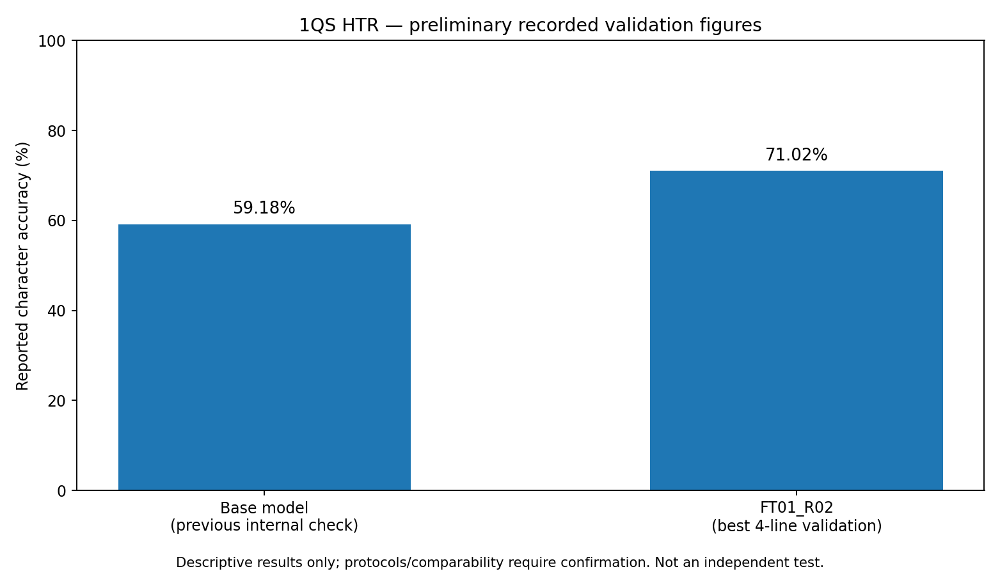

# Qumran Analytics

**Computer vision and Hebrew handwriting recognition for the Dead Sea Scrolls (1QS)**

> **Research status — work in progress (13 October 2026).** Initial model fine-tuning is complete; independent test-set transcription and evaluation are **not yet complete**. Reported metrics below are exploratory validation results, **not** held-out test accuracy.

[English](README.md) · [Português](README.pt-BR.md) · [Methodology](docs/METHODOLOGY.md) · [Data policy](docs/DATA_AND_RIGHTS.md) · [Research limitations](docs/LIMITATIONS.md)

## Overview

Qumran Analytics investigates a computational workflow for analyzing the **Community Rule (1QS)** among the Dead Sea Scrolls. The study combines manuscript image processing, region-of-interest selection, line segmentation, audit trails, and Hebrew handwritten-text recognition (HTR). It explores whether fine-tuning an existing recognition model can improve character recognition on a carefully documented sample.

This is an **exploratory research prototype**, not a validated transcription service or a published benchmark.

## Research pipeline

```text
Manuscript image source (rights and attribution to be verified)
  → image preparation and region-of-interest selection
  → physical-line segmentation and manual audit
  → ground-truth curation and reference reconciliation
  → train / validation / held-out test partitioning
  → Kraken / PP-OCRv6-based HTR fine-tuning
  → validation analysis and integrity checks
  → independent expert transcription [pending]
  → held-out test metrics and error analysis [pending]
```

## Current experimental record

| Item | Recorded status |
|---|---|
| Manuscript | 1QS, 11 columns |
| Fine-tuning | FT01_R02 — Kraken 7.1.1, PP-OCRv6-based pretrained model |
| Training images/lines | 55 |
| Primary validation lines | 4 |
| Reserved test lines | 11 (one selected per column) |
| Training duration | 30 epochs; GPU Tesla T4 |
| Baseline character accuracy | 59.18% (reported earlier in the notebook) |
| Best recorded validation accuracy | 71.02% (checkpoint 13 / epoch index 13; selected on validation) |
| Held-out test accuracy | **Not available** |



**Interpretation:** These figures come from different steps of the original research notebook and are reported for orientation, **not as a controlled apples-to-apples test comparison**. In particular, the best checkpoint is selected on a validation set of only four lines, and there is no independent test metric yet. It would be premature to claim a confirmed improvement in generalization.

## What's in this repository?

```text
qumran-analytics/
├── README.md / README.pt-BR.md
├── CITATION.cff
├── .gitignore
├── .github/workflows/quality.yml
├── assets/figures/validation_accuracy.png
├── docs/
│   ├── METHODOLOGY.md
│   ├── LIMITATIONS.md
│   ├── DATA_AND_RIGHTS.md
│   └── REPRODUCIBILITY.md
├── notebooks/
│   ├── README.md
│   ├── 01_metrics_walkthrough.ipynb
│   └── research_log_redacted.ipynb
├── results/validation_summary.csv
├── examples/predictions_template.csv
├── scripts/evaluate_htr.py
├── scripts/audit_overlap.py
├── src/qumran_analytics/
│   ├── __init__.py
│   ├── metrics.py
│   └── geometry.py
└── tests/test_metrics.py
```

The redacted notebook preserves a **historical code record**, not a cleaned, end-to-end executable pipeline. Some cells depend on private Drive directories and research artifacts and some have intentionally been removed. The small metric/geometry utilities are runnable locally without restricted data.

## Quick start: reproducible, data-free examples

Requires Python 3.10+; the example utility code uses the standard library only.

```bash
python -m unittest discover -s tests -v
python scripts/evaluate_htr.py --csv examples/predictions_template.csv --help
```

To evaluate **your own authorized data**, create a UTF-8 CSV with columns `htr_line_id,reference,prediction` and run:

```bash
python scripts/evaluate_htr.py --csv my_predictions.csv --normalization NFD
```

**No test ground truth, manuscript imagery, licensed textual datasets, or model checkpoints are distributed here.** The original source assets and experiment records are stored separately by the researcher. See [reproducibility](docs/REPRODUCIBILITY.md) for the limitations of the current public release.

## Next scientific milestone

1. Independently adjudicate the possible train–test region overlaps flagged in the audit.
2. Obtain specialist image-based transcription of the 11 held-out test line images; preserve the pre-registered split and hashes.
3. Run baseline and fine-tuned models on the same locked test split with the same normalization and decoding procedure.
4. Report micro-averaged character error rate (CER), word error rate (WER), individual line errors, uncertainty, and interpretive limitations.
5. Review manuscript-image rights and reference-text reuse terms before releasing additional datasets or illustrations.

## Citation and reuse

See [`CITATION.cff`](CITATION.cff). **No software license has been selected for this initial release**; public visibility is not equivalent to permission to redistribute or modify code. The owner may add a suitable software license separately after review. Third-party manuscript images and editorial text would require their **own** license assessment.

## Research credit

**João Paulo Fortes** — research and computational workflow. This is an independently documented work-in-progress repository; institutional endorsement, peer review and expert validation should **not** be inferred.
